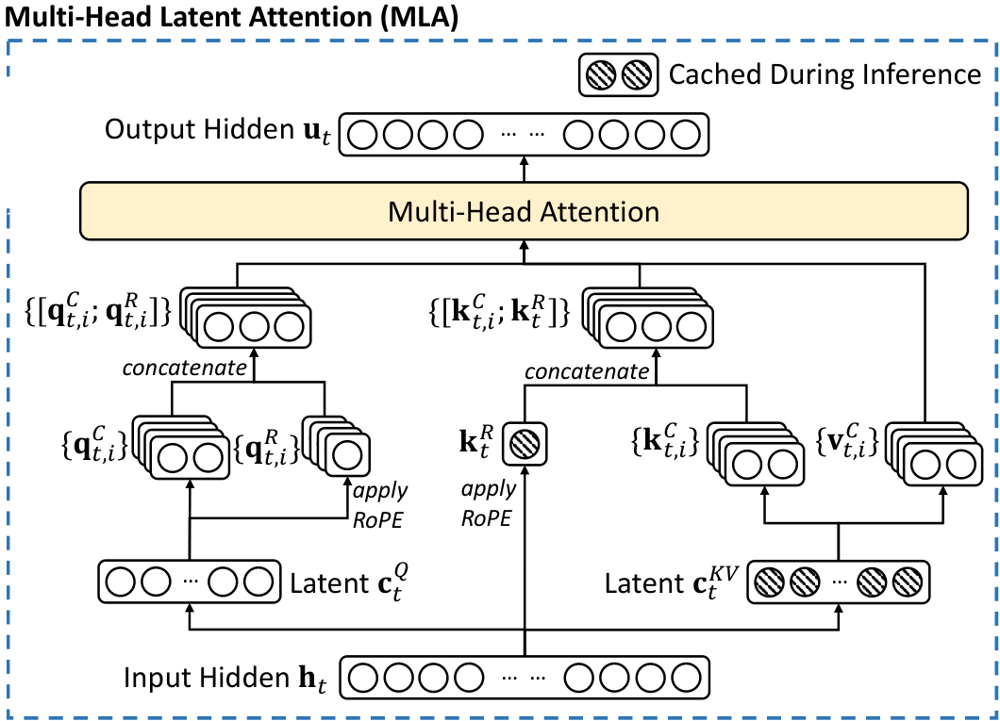

## DeepSeek MLA intro

Multi-head Latent Attention (MLA) is an attention mechanism designed by DeepSeek to reduce KV cache memory pressure.
It is used in models like DeepSeek-V2/V3/R1, Kimi K2.6, etc.

**How does it make it?**
Instead of caching per-head keys and values, each layer caches one compressed latent $\c_j$ (512 values) plus one
RoPE key $\k^R_j$ shared by all heads (64 values) per token: 576 values, instead of the 32,768 per-head
keys and values (128 heads × 128 dims × 2) that standard multi-head attention would cache at the same head size.

MLA can be implemented in two ways, with tradeoff on FLOPs: 
- The **naive form** decompresses the KV cache first, and then runs ordinary multi-head attention. 
  - It requires less FLOPs when query length is long (>171 for DeepSeek V2), so it is used in prefill
- The **absorbed form** skips the direct KV cache decompression, works around it with matrix multiplication associativity. 
  - It requires less FLOPs when query length is short, so it is used in decode

This post explains that they share the same math, and explains their difference in FLOPs.

### What it is: the naive form



:::muted
The MLA part of Figure 2 in the DeepSeek-V2 paper (arXiv 2405.04434).
:::

The figure is the naive form, read bottom to top. The input $\h_t$ is compressed into a query latent $\c^Q_t$ and a
KV latent $\c^{KV}_t$; only $\c^{KV}_t$ and the RoPE key $\k^R_t$ (hatched) are cached. At attention time the latent is
up-projected into per-head keys $\k^C_{t,i}$ and values $\v^C_{t,i}$, the shared $\k^R_t$ is concatenated onto every
head's key, and the result goes through standard multi-head attention.

### Its math

::::neutral
| Symbol | Shape | Meaning | DeepSeek-V2 |
|---|---|---|---|
| $d_c$ | scalar | KV latent dimension: size of the compressed latent cached per token | 512 |
| $d_h$ | scalar | per-head dimension of the non-RoPE query/key part (and of the value) | 128 |
| $d_h^R$ | scalar | per-head dimension of the decoupled RoPE query/key | 64 |
| $n_h$ | scalar | number of attention heads | 128 |
| $d$ | scalar | hidden size of the model | 5120 |
| $\c_j$ | $\R^{d_c}$ | cached KV latent of token $j$ ($= \c^{KV}_j$) | $d_c = 512$ |
| $\k^R_j$ | $\R^{d_h^R}$ | cached RoPE key, **shared by all heads** | $d_h^R = 64$ |
| $\q^C_{t,i}$ | $\R^{d_h}$ | non-RoPE query of token $t$, head $i$ | $d_h = 128$ |
| $\q^R_{t,i}$ | $\R^{d_h^R}$ | RoPE query of token $t$, head $i$ | 64 |
| $\UK_i$ | $\R^{d_h \times d_c}$ | key up-projection, rows of head $i$ | $128 \times 512$ |
| $\UV_i$ | $\R^{d_h \times d_c}$ | value up-projection, rows of head $i$ | $128 \times 512$ |
| $W^O_i$ | $\R^{d \times d_h}$ | column block of $W^O$ that multiplies head $i$ | $5120 \times 128$ |
| $\u_t$ | $\R^{d}$ | output of the attention layer for token $t$: all heads' outputs concatenated and projected by $W^O$ | $d = 5120$ |
| $\tau$ | scalar | softmax scale $1/\sqrt{d_h + d_h^R}$ | $1/\sqrt{192}$ |

:::muted
$\UK = [\UK_1; \dots; \UK_{n_h}]$ stacked by rows, likewise $\UV$. In code these are the two halves of
`wkv_b.weight.view(H, 256, 512)`.
:::
::::

For one layer and one head $i$, the naive form builds per-head keys, values and queries:

$$
\k_{j,i} = \begin{bmatrix} \UK_i \c_j \\ \k^R_j \end{bmatrix} \in \R^{d_h + d_h^R},
\qquad
\v_{j,i} = \UV_i \c_j \in \R^{d_h},
\qquad
\q_{t,i} = \begin{bmatrix} \q^C_{t,i} \\ \q^R_{t,i} \end{bmatrix}
$$

and then runs standard attention:

$$
s^{\text{naive}}_{t,j,i} = \tau\, \q_{t,i}\T \k_{j,i},
\qquad
p_{t,j,i} = \operatorname{softmax}_j\!\big(s_{t,j,i} + m_{t,j}\big),
\qquad
\o^{\text{naive}}_{t,i} = \sum_{j} p_{t,j,i}\, \v_{j,i}
$$

$$
\u^{\text{naive}}_t = W^O\big[\o^{\text{naive}}_{t,1}; \dots; \o^{\text{naive}}_{t,n_h}\big]
$$

:::muted
$m_{t,j} \in \{0, -\infty\}$ is the causal mask.
:::

### Its code

A minimal PyTorch implementation. The layer's `forward` is shared by both forms: it projects the queries, writes the
latent to the cache, and then hands off to `_attn_naive` (or `_attn_absorb`, covered below):

```python
def forward(self, x, start_pos: int, mode: str):
    cfg = self.cfg
    B, S, _ = x.shape
    H = cfg.num_heads
    end = start_pos + S
    cos, sin = rope_cos_sin(cfg, x.device, x.dtype)
    cos, sin = cos[start_pos:end], sin[start_pos:end]

    # ---- queries (identical for both modes) ----
    q = self.wq_b(self.q_norm(self.wq_a(x))).view(B, S, H, self.qk_head_dim)
    q_nope, q_pe = q.split([cfg.qk_nope_head_dim, cfg.qk_rope_head_dim], dim=-1)
    q_pe = apply_rope(q_pe, cos[:, None], sin[:, None])                 # [B,S,H,64]

    # ---- write latent to cache (identical for both modes) ----
    kv = self.wkv_a(x)
    c_kv, k_pe = kv.split([cfg.kv_lora_rank, cfg.qk_rope_head_dim], dim=-1)
    self.kv_cache[:B, start_pos:end] = self.kv_norm(c_kv)              # [B,S,512]
    self.pe_cache[:B, start_pos:end] = apply_rope(k_pe, cos, sin)      # [B,S,64], shared across heads

    c_kv_all = self.kv_cache[:B, :end]                                 # [B,T,512]
    k_pe_all = self.pe_cache[:B, :end]                                 # [B,T,64]

    # causal mask over absolute positions
    mask = None
    if S > 1:
        qpos = torch.arange(start_pos, end, device=x.device)[:, None]
        kpos = torch.arange(end, device=x.device)[None, :]
        mask = torch.zeros(S, end, device=x.device, dtype=x.dtype).masked_fill(kpos > qpos, float("-inf"))

    if mode == "naive":
        o = self._attn_naive(q_nope, q_pe, c_kv_all, k_pe_all, mask)
    elif mode == "absorb":
        o = self._attn_absorb(q_nope, q_pe, c_kv_all, k_pe_all, mask)
    else:
        raise ValueError(mode)
    return self.wo(o.flatten(2))                                       # eq. 19
```

The naive attention decompresses every cached token into per-head K and V, then runs plain MHA:

```python
def _attn_naive(self, q_nope, q_pe, c_kv, k_pe, mask):
    cfg = self.cfg
    B, T, _ = c_kv.shape
    H = cfg.num_heads

    # Up-project every cached token: [B,T,512] -> [B,T,H,128+128]
    kv = self.wkv_b(c_kv).view(B, T, H, cfg.qk_nope_head_dim + cfg.v_head_dim)
    k_nope, v = kv.split([cfg.qk_nope_head_dim, cfg.v_head_dim], dim=-1)   # [B,T,H,128] each

    # Per-head key = [k^C_i ; k^R] (eq. 17), k^R broadcast to all heads
    k = torch.cat([k_nope, k_pe[:, :, None].expand(-1, -1, H, -1)], dim=-1)  # [B,T,H,192]
    q = torch.cat([q_nope, q_pe], dim=-1)                                   # [B,S,H,192]

    scores = torch.einsum("bshd,bthd->bsht", q, k) * self.scale            # 192-dim dots
    if mask is not None:
        scores = scores + mask[None, :, None, :]
    p = scores.softmax(dim=-1)
    return torch.einsum("bsht,bthd->bshd", p, v)                           # [B,S,H,128]
```

| Math | Code |
|---|---|
| $\UK_i\c_j$, $\UV_i\c_j$ | `kv = self.wkv_b(c_kv).view(B, T, H, 256)` |
| $\k_{j,i} = [\UK_i\c_j;\ \k^R_j]$ | `torch.cat([k_nope, k_pe[:, :, None].expand(...)], dim=-1)` |
| $s_{t,j,i} = \tau\,\q_{t,i}\T\k_{j,i}$ | `einsum("bshd,bthd->bsht", q, k) * self.scale` |
| $\o_{t,i} = \sum_j p_{t,j,i}\,\v_{j,i}$ | `einsum("bsht,bthd->bshd", p, v)` |

## The absorbed form of MLA

The naive form unpacks every KV latent back into full keys and values, which gets expensive as the context grows (e.g., decoding phase of LLM inference). Because the order of matrix multiplications can be changed (associativity), we can do that unpacking on the query and output side instead, once per new token, and attend to the compressed cache directly.

### Its math

The absorbed form never decompresses KV latent. It multiplies $\UK_i$ with the query, and multiplies $\UV_i$ with the output:

$$
\tilde{\q}_{t,i} = (\UK_i)\T \q^C_{t,i} \in \R^{d_c}
$$

$$
s^{\text{absorb}}_{t,j,i} = \tau \left( \tilde{\q}_{t,i}\T \c_j + (\q^R_{t,i})\T \k^R_j \right),
\qquad
p^{\text{absorb}}_{t,j,i} = \operatorname{softmax}_j\!\big(s^{\text{absorb}}_{t,j,i} + m_{t,j}\big)
$$

$$
\tilde{\o}_{t,i} = \sum_j p^{\text{absorb}}_{t,j,i}\, \c_j \in \R^{d_c},
\qquad
\o^{\text{absorb}}_{t,i} = \UV_i\, \tilde{\o}_{t,i} \in \R^{d_h}
$$

$$
\u^{\text{absorb}}_t = W^O\big[\o^{\text{absorb}}_{t,1}; \dots; \o^{\text{absorb}}_{t,n_h}\big]
$$

Concatenating the two score terms gives an equivalent “MQA” view:

$$
s^{\text{absorb}}_{t,j,i} = \tau
\underbrace{\begin{bmatrix} \tilde{\q}_{t,i} \\ \q^R_{t,i} \end{bmatrix}\T}_{\text{per head, } 576}
\underbrace{\begin{bmatrix} \c_j \\ \k^R_j \end{bmatrix}}_{\text{shared, } 576}
$$

The key vector $[\c_j; \k^R_j]$ has no head index $i$: every head attends to the same 576-dim key.
This is exactly multi-query attention with $n_h = 128$ query heads. It is also exactly what the KV cache stores.

### Why they are the same

:::green
**Claim.** For every $t, i$: $\;\o^{\text{absorb}}_{t,i} = \o^{\text{naive}}_{t,i}$, and therefore $\u_t$ is identical.
:::

#### Step 1: the attention scores are identical

Expand the naive score using the block structure of $\q_{t,i}$ and $\k_{j,i}$
(a dot product of concatenated vectors is the sum of the blockwise dot products):

$$
\begin{aligned}
s^{\text{naive}}_{t,j,i}
&= \tau \begin{bmatrix} \q^C_{t,i} \\ \q^R_{t,i} \end{bmatrix}\T
        \begin{bmatrix} \UK_i \c_j \\ \k^R_j \end{bmatrix} \\[4pt]
&= \tau \Big( (\q^C_{t,i})\T \,\UK_i \c_j \;+\; (\q^R_{t,i})\T \k^R_j \Big)
\end{aligned}
$$

Now regroup the first term. Matrix multiplication is associative, and $(A\mathbf{x})\T = \mathbf{x}\T A\T$:

$$
(\q^C_{t,i})\T \big(\UK_i \c_j\big)
\;=\; \big((\q^C_{t,i})\T \UK_i\big)\, \c_j
\;=\; \big((\UK_i)\T \q^C_{t,i}\big)\T \c_j
\;=\; \tilde{\q}_{t,i}\T \c_j
$$

Substituting back:

$$
s^{\text{naive}}_{t,j,i} = \tau \left( \tilde{\q}_{t,i}\T \c_j + (\q^R_{t,i})\T \k^R_j \right) = s^{\text{absorb}}_{t,j,i}
$$

Same scores and the same mask $\Rightarrow$ the same softmax probabilities $p_{t,j,i}$ in both forms. $\blacksquare_1$

#### Step 2: the head outputs are identical

Start from the naive output and substitute $\v_{j,i} = \UV_i \c_j$:

$$
\o^{\text{naive}}_{t,i}
= \sum_j p_{t,j,i}\, \UV_i \c_j
$$

$\UV_i$ does not depend on $j$, and $p_{t,j,i}$ is a scalar, so by linearity the matrix factors out of the sum:

$$
\sum_j p_{t,j,i}\, \UV_i \c_j
\;=\; \UV_i \sum_j p_{t,j,i}\, \c_j
\;=\; \UV_i\, \tilde{\o}_{t,i}
\;=\; \o^{\text{absorb}}_{t,i}
$$

:::muted
The $p_{t,j,i}$ are equal by Step 1. Naive up-projects every *key* token, then averages;
absorbed averages the latents, then up-projects once per *query*.
:::

$\blacksquare_2$ — hence $\u_t = W^O[\o_{t,1}; \dots; \o_{t,n_h}]$ is identical too. $\blacksquare$

:::amber
**Numerics.** The equality holds in exact arithmetic (running both forms in float64 gives differences around $10^{-15}$).
In bf16/fp8 the two forms round differently, because the products are grouped differently, so outputs match only to within normal low-precision error.
:::

### Its code

The same `forward` (shown in the naive form's code) calls `_attn_absorb` when `mode == "absorb"`. It slices $\UK$ and $\UV$ out of the same `wkv_b` weight and never materializes K or V:

```python
def _attn_absorb(self, q_nope, q_pe, c_kv, k_pe, mask):
    cfg = self.cfg
    H = cfg.num_heads

    w = self.wkv_b.weight.view(H, cfg.qk_nope_head_dim + cfg.v_head_dim, cfg.kv_lora_rank)
    w_uk = w[:, : cfg.qk_nope_head_dim]      # [H,128,512]  W^UK per head
    w_uv = w[:, cfg.qk_nope_head_dim :]      # [H,128,512]  W^UV per head

    # Absorb W^UK into the query: 128-dim -> 512-dim latent query per head
    q_lat = torch.einsum("bshd,hdc->bshc", q_nope, w_uk)                   # [B,S,H,512]

    # Scores = latent part + RoPE part; K is the SAME [T,576] for all heads (MQA-like)
    scores = (
        torch.einsum("bshc,btc->bsht", q_lat, c_kv)                        # 512-dim dots
        + torch.einsum("bshr,btr->bsht", q_pe, k_pe)                       # 64-dim dots
    ) * self.scale
    if mask is not None:
        scores = scores + mask[None, :, None, :]
    p = scores.softmax(dim=-1)

    # Values are the latent itself; apply W^UV after the weighted sum
    o_lat = torch.einsum("bsht,btc->bshc", p, c_kv)                        # [B,S,H,512]
    return torch.einsum("bshc,hdc->bshd", o_lat, w_uv)                     # [B,S,H,128]
```

| Math | Code |
|---|---|
| $\UK_i$, $\UV_i$ | `w = wkv_b.weight.view(H, 256, 512)`; `w_uk = w[:, :128]`, `w_uv = w[:, 128:]` |
| $\tilde{\q}_{t,i} = (\UK_i)\T\q^C_{t,i}$ | `einsum("bshd,hdc->bshc", q_nope, w_uk)` |
| $\tilde{\q}\T\c_j + (\q^R)\T\k^R_j$ | `einsum("bshc,btc->bsht", q_lat, c_kv) + einsum("bshr,btr->bsht", q_pe, k_pe)` |
| $\tilde{\o}_{t,i} = \sum_j p\,\c_j$ | `einsum("bsht,btc->bshc", p, c_kv)` |
| $\UV_i\tilde{\o}_{t,i}$ | `einsum("bshc,hdc->bshd", o_lat, w_uv)` |

Running a prompt plus a few decode steps through both forms with the same weights gives
`max |naive - absorb|` at the $10^{-15}$ level in float64.

## Comparison

The two forms share a similar memory workload, but different FLOPs depending on query length and context length.

### Memory

| Memory, per cached token | Naive | Absorbed |
|---|---|---|
| Read from the KV cache | $d_c + d_h^R = 512 + 64 = 576$ values | $d_c + d_h^R = 512 + 64 = 576$ values |
| Intermediate K/V the attention kernel needs | $n_h \cdot 2d_h = 128 \times (128 + 128) = 32{,}768$ values: $K^C$ and $V$ for every head (written to HBM and re-read, unless the decompression is fused into the kernel) | none (it attends to the latent directly) |

### FLOPs per call

Costs are for one layer, attention core only. $S$ = query tokens in the call, $T$ = cached (context) tokens attended to.
FLOPs = 2 × multiply-adds. The projections that produce $\c^Q$, $\q^C$, $\q^R$, $\c_j$, $\k^R_j$ and the final $W^O$
are identical in both forms and are left out. Shapes are written [batch, rows, cols], with the head dimension $n_h$ first when there is one; a shape without $n_h$ is shared by all heads. Numbers use $n_h=128,\ d_h=128,\ d_h^R=64,\ d_c=512$.

| Computation | Naive: shapes | Naive: FLOPs | Absorbed: shapes | Absorbed: FLOPs |
|---|---|---|---|---|
| Decompress K/V<br>$\UK_i\c_j,\ \UV_i\c_j$ | $C\,[T, d_c]$<br>$\times\ W^{UKV}\,[d_c,\ n_h{\cdot}2d_h]$<br>$\to [T, n_h, 2d_h]$<br><span class="muted">split into $K^C, V$: $[T, n_h, d_h]$ each</span> | $2\,T\,d_c\,n_h(2d_h)$<br>= **33.6M · T** | — | — |
| Absorb into query<br>$(\UK_i)\T\q^C_{t,i}$ | — | — | $Q^C\,[n_h, S, d_h]$<br>$\times\ \UK\,[n_h, d_h, d_c]$<br>$\to \tilde{Q}\,[n_h, S, d_c]$<br><span class="muted">batched over heads</span> | $2\,S\,n_h\,d_h\,d_c$<br>= **16.8M · S** |
| Scores $QK\T$ | $Q\,[n_h, S, d_h{+}d_h^R]$<br>$\times\ K\T\,[n_h, d_h{+}d_h^R, T]$<br>$\to [n_h, S, T]$<br><span class="muted">a separate K per head</span> | $2\,S\,T\,n_h(d_h{+}d_h^R)$<br>= **49,152 · ST** | $[\tilde{Q}; Q^R]\,[n_h, S, d_c{+}d_h^R]$<br>$\times\ [C; K^R]\T\,[d_c{+}d_h^R, T]$<br>$\to [n_h, S, T]$<br><span class="muted">one K shared by all heads (MQA)</span> | $2\,S\,T\,n_h(d_c{+}d_h^R)$<br>= **147,456 · ST** |
| Weighted sum $PV$ | $P\,[n_h, S, T]$<br>$\times\ V\,[n_h, T, d_h]$<br>$\to O\,[n_h, S, d_h]$ | $2\,S\,T\,n_h\,d_h$<br>= **32,768 · ST** | $P\,[n_h, S, T]$<br>$\times\ C\,[T, d_c]$<br>$\to \tilde{O}\,[n_h, S, d_c]$<br><span class="muted">the latent itself is V, shared by all heads</span> | $2\,S\,T\,n_h\,d_c$<br>= **131,072 · ST** |
| Up-project output<br>$\UV_i\tilde{\o}_{t,i}$ | — | — | $\tilde{O}\,[n_h, S, d_c]$<br>$\times\ (\UV)\T\,[n_h, d_c, d_h]$<br>$\to O\,[n_h, S, d_h]$<br><span class="muted">batched over heads</span> | $2\,S\,n_h\,d_c\,d_h$<br>= **16.8M · S** |

| | Naive | Absorbed |
|---|---|---|
| **Total** | $4\,n_h\,d_c\,d_h\,T + 2\,n_h(2d_h + d_h^R)\,S\,T$ | $4\,n_h\,d_c\,d_h\,S + 2\,n_h(2d_c + d_h^R)\,S\,T$ |
| **Total for DeepSeek V2** | **33.6M · T + 81,920 · ST** | **33.6M · S + 278,528 · ST** |
| **Prefill**: $S=T=4096$ | 0.14T + 1.37T ≈ **1.51 TFLOPs** (≈3.2× less) | 0.14T + 4.67T ≈ **4.81 TFLOPs** |
| **Decode**: $S=1,\ T=4096$ | 137.4G + 0.3G ≈ **137.8 GFLOPs** | 0.03G + 1.14G ≈ **1.17 GFLOPs** (≈118× less) |

:::muted
The $ST$ terms ignore causal masking. A kernel that skips masked blocks roughly halves them in prefill. That doesn't change the ratio.
:::

How to read the totals: naive pays a large cost per *key* token (decompression, 33.6M · T) plus cheap attention.
Absorbed pays the same-sized cost per *query* token (33.6M · S) plus attention that is about 3.4× more expensive.
When $S \ll T$ (decode), absorbed wins by a wide margin. When $S \approx T$ (prefill), the per-token terms cancel and
the cheaper attention makes naive win.

### Crossover point

This section is to answer, under what condition the naive form has cheaper FLOPs than the absorbed form.

Using the totals above, the naive form is cheaper when

$$
2\,T\,d_c\,n_h(2d_h) + 2\,S\,T\,n_h(2d_h + d_h^R) \;\le\; 2\,S\,n_h\,d_c(2d_h) + 2\,S\,T\,n_h(2d_c + d_h^R)
$$

Move the decompression and absorption terms to the left and the attention terms to the right; $n_h$ and $d_h^R$ cancel:

$$
2\,d_c\,d_h\,(T - S) \;\le\; 2\,S\,T\,(d_c - d_h)
$$

Divide both sides by $2\,T\,(d_c - d_h)$:

$$
\alpha \Big(1 - \frac{S}{T}\Big) \;\le\; S,
\qquad
\alpha = \frac{d_c\, d_h}{d_c - d_h}
$$

$\alpha$ depends only on the latent and head sizes. For DeepSeek-V2, $\alpha = \frac{512 \times 128}{512 - 128} \approx 171$ query tokens.

There are two situations now:
- When $T \gg S$ (decode, or prefill with a high cache hit rate). Then $1 - S/T \approx 1$ and the condition becomes $S \gtrsim \alpha \approx 171$. It means that if the query length is longer than 171, the naive form has cheaper FLOPs.
  - This is why the naive form is used in prefill ($S > 171$), and the absorbed form is used in decode ($S < 171$).
- When $T = S$ (prefill without a cache). Then $1 - S/T = 0$ and the condition $0 \le S$ always holds, so the **naive form** wins for any prompt length.

:::muted
Solving for $S$ gives the crossover $S^{*} = \frac{\alpha T}{T + \alpha}$, which is always below $\alpha$ and approaches it as the context grows. These are FLOP counts only; real engines also weigh kernel efficiency and the memory needed to materialize K/V.
:::

## Estimating FLOPs: naive prefill + absorbed decode

Attention work grows with the number of (query token, context token) pairs, so count FLOPs per pair, per layer,
then add the one extra cost the naive form has: decompressing the context.

### Per (query, context) pair

For one head, each pair does two dot-product-sized pieces of work:

1. **Score:** $\q \cdot \k$ over $d_{qk}$ dimensions, i.e. $d_{qk}$ multiply-adds $= 2\,d_{qk}$ FLOPs.
2. **Weighted value:** accumulate $p \cdot \v$ over $d_v$ dimensions $= 2\,d_v$ FLOPs.

So one head costs $2\,(d_{qk} + d_v)$ FLOPs per pair; the softmax itself is negligible.

| Form | $d_{qk}$ | $d_v$ | Per head | × $n_h = 128$ heads | × 60 layers |
|---|---|---|---|---|---|
| Naive | $d_h + d_h^R = 192$ | $d_h = 128$ | $2\,(192 + 128) = 640$ | 81,920 | 4.9 M |
| Absorbed | $d_c + d_h^R = 576$ | $d_c = 512$ | $2\,(576 + 512) = 2{,}176$ | 278,528 | 16.7 M |

The absorbed form is about 3.4× more expensive per pair, because every head works in the 512-dim latent space instead of its own 128-dim head space.

### Decompression (naive only)

The cache stores only the latent, so the naive form must rebuild per-head $K^C$ and $V$ for every context token, in every call:

$$
F_{\text{decomp}} = 2\, d_c\, n_h\, (d_h + d_v) = 2 \times 512 \times 128 \times (128 + 128) \approx 33.6\ \text{MFLOP per context token, per layer}
$$

:::muted
$\k^R_j$ is cached as-is and shared by all heads, so it needs no decompression. The absorbed form has no such term.
:::

:::blue[FLOPs estimate, attention core]
A request has $C$ cached context tokens, $S$ new prompt tokens and $N$ output tokens; the model has $L$ layers.

**Prefill, naive form** ($S$ queries over $C + S$ keys, causal):

$$
F_{\text{prefill}} \approx \underbrace{\Big[S\,C + \tfrac{S(S+1)}{2}\Big]}_{\text{(query, context) pairs}} \cdot \underbrace{2\,(d_h + d_h^R + d_h)\, n_h}_{81{,}920} \cdot L
\;+\; \underbrace{(C + S)}_{\text{context tokens}} \cdot \underbrace{2\, d_c\, n_h\, (d_h + d_v)}_{33.6\,\text{M}} \cdot L
$$

**Decode, absorbed form** (one query per step, step $k$ attends to $C + S + k$ tokens):

$$
F_{\text{decode}} \approx \underbrace{\Big[N\,(C + S) + \tfrac{N(N+1)}{2}\Big]}_{\text{(query, context) pairs}} \cdot \underbrace{2\,(d_c + d_h^R + d_c)\, n_h}_{278{,}528} \cdot L
$$
:::

### Example: 100k context, 95% cache hit, 1k output

One request with a 100k-token prompt, of which 95k tokens are already in the prefix cache, so prefill processes only $S = 5{,}000$ new tokens; then it generates 1,000 output tokens. DeepSeek-V2 sizes, 60 layers, attention core only.

**Prefill (one call).** The 5k new tokens attend to the 95k cached tokens plus, causally, to each other:

$$
\text{pairs} = 5{,}000 \times 95{,}000 + \tfrac{5{,}000 \times 5{,}001}{2} \approx 4.88 \times 10^{8}
$$

| | Naive | Absorbed |
|---|---|---|
| Attention: pairs × per-pair × 60 layers | $4.88 \times 10^8 \times 81{,}920 \times 60 \approx$ 2.40 PFLOP | $4.88 \times 10^8 \times 278{,}528 \times 60 \approx$ 8.15 PFLOP |
| Decompression: 100k context tokens × 33.6 M × 60 | 0.20 PFLOP | — |
| **Total** | **2.60 PFLOP** | **8.15 PFLOP** (3.1× more) |

**Decode (1,000 steps).** Step $k$ has one query token attending to $100{,}000 + k$ tokens, so over all steps:

$$
\text{pairs} = \sum_{k=1}^{1000} (100{,}000 + k) \approx 1.005 \times 10^{8}
$$

| | Naive | Absorbed |
|---|---|---|
| Attention: pairs × per-pair × 60 layers | 0.49 PFLOP | $1.005 \times 10^8 \times 278{,}528 \times 60 \approx$ 1.68 PFLOP |
| Decompression: ≈100k context tokens × 33.6 M × 60, **every step** | 202 PFLOP | — |
| **Total** | **203 PFLOP** (121× more) | **1.68 PFLOP** (≈1.7 TFLOP per output token) |

**Whole request**, attention core only:

| Strategy | FLOPs |
|---|---|
| Naive prefill + absorbed decode | 2.60 + 1.68 ≈ **4.3 PFLOP** |
| Naive for both | 2.60 + 203 ≈ 206 PFLOP (48× more) |
| Absorbed for both | 8.15 + 1.68 ≈ 9.8 PFLOP (2.3× more) |

:::muted
Decompression counts all 100k context tokens, the 5k new ones included, since naive attention needs per-head K/V for every key. With chunked prefill, the cached context is decompressed again in every chunk: 5 chunks of 1k would decompress $95\text{k} + 96\text{k} + \dots + 99\text{k}$ tokens, about 5× the single-call cost.
:::

## Related discussion about the absorbed form MLA

### Folding into neighbouring weights (valid, but not done in practice)

Since $\q^C_{t,i} = W^{UQ}_i \c^Q_t$ (eq. 13), the absorbed query is a fixed linear map of $\c^Q_t$:

$$
\tilde{\q}_{t,i} = (\UK_i)\T W^{UQ}_i\, \c^Q_t
= \underbrace{\big((\UK_i)\T W^{UQ}_i\big)}_{\text{precompute: } d_c \times d_c'}\, \c^Q_t
$$

On the output side, split $W^O$ into per-head column blocks:

$$
\u_t = \sum_{i=1}^{n_h} W^O_i\, \o_{t,i}
= \sum_{i=1}^{n_h} W^O_i \UV_i\, \tilde{\o}_{t,i}
= \sum_{i=1}^{n_h} \underbrace{\big(W^O_i \UV_i\big)}_{\text{precompute: } d \times d_c}\, \tilde{\o}_{t,i}
$$

This is the paper's sentence: “$\UK$ can be absorbed into $W^Q$, and $\UV$ into $W^O$.”
Whether to precompute these products is a cost trade-off. The math is identical either way.
The code above applies $\UK_i$ and $\UV_i$ at runtime instead.

::::amber
**Note: actual implementations do *not* precompute these products (checked 2026-10-20).**
Folding is valid math, but it costs more, because it removes the low-rank bottleneck. Per token, per layer, at DeepSeek-V2 sizes:

| | Unfolded: shapes | Unfolded: FLOPs per token | Folded: shapes | Folded: FLOPs per token |
|---|---|---|---|---|
| Query<br>$\c^Q_t \to \tilde{\q}_t$ | ① $C^Q\,[S, d_c']$<br>$\times\ W^{UQ}\,[d_c',\ n_h{\cdot}d_h]$<br>$\to Q^C\,[S, n_h, d_h]$<br>② $Q^C\,[n_h, S, d_h]$<br>$\times\ \UK\,[n_h, d_h, d_c]$<br>$\to \tilde{Q}\,[n_h, S, d_c]$ | ① $2\,d_c'\,n_h d_h$ = 50.3M<br>② $2\,n_h d_h d_c$ = 16.8M<br>= **67.1M** | $C^Q\,[S, d_c']$<br>$\times\ W^{UQK}\,[d_c',\ n_h{\cdot}d_c]$<br>$\to \tilde{Q}\,[S, n_h, d_c]$<br><span class="muted">$W^{UQK}_i = (\UK_i)\T W^{UQ}_i$</span> | $2\,d_c'\,n_h d_c$<br>= **201M** (3×) |
| Output<br>$\tilde{\o}_t \to \u_t$ | ① $\tilde{O}\,[n_h, S, d_c]$<br>$\times\ (\UV)\T\,[n_h, d_c, d_h]$<br>$\to O\,[n_h, S, d_h]$<br>② $O\,[S,\ n_h{\cdot}d_h]$<br>$\times\ (W^O)\T\,[n_h{\cdot}d_h, d]$<br>$\to U\,[S, d]$ | ① $2\,n_h d_c d_h$ = 16.8M<br>② $2\,n_h d_h\,d$ = 167.8M<br>= **184.5M** | $\tilde{O}\,[S,\ n_h{\cdot}d_c]$<br>$\times\ (W^{OV})\T\,[n_h{\cdot}d_c, d]$<br>$\to U\,[S, d]$<br><span class="muted">$W^{OV}_i = W^O_i \UV_i$</span> | $2\,n_h d_c\,d$<br>= **671M** (3.6×) |

| Weight parameters | Paramater to load (unfolded) | Paramater to load (folded) |
|---|---|---|
| Query side | $W^{UQ}$: $d_c' \cdot n_h d_h$ = 25.2M | $W^{UQK}$: $d_c' \cdot n_h d_c$ = 100.7M |
| Output side | $W^O$: $n_h d_h \cdot d$ = 83.9M | $W^{OV}$: $n_h d_c \cdot d$ = 335.5M |
| Note | <span class="muted">plus $\UK, \UV$: $d_c \cdot n_h 2d_h$ = 16.8M, already in `wkv_b`</span> | <span class="muted">≈4×, ≈+20B parameters over 60 layers</span> |

:::muted
$d = 5120$ (hidden size), $d_c' = 1536$ (query latent), $d_c = 512$, $n_h = d_h = 128$. A shape without $n_h$ first is a plain 2-D matmul over tokens.
:::

::::

### Why RoPE has to be decoupled

Suppose RoPE were applied directly to the compressed key and query, with rotation matrices $R_t$ for position $t$:

$$
(R_t \q^C_{t,i})\T (R_j \UK_i \c_j)
= (\q^C_{t,i})\T \, \underbrace{R_t\T R_j}_{=\,R_{j-t}} \, \UK_i \c_j
= \Big( (\UK_i)\T R_{j-t}\T \q^C_{t,i} \Big)\T \c_j
$$

The “absorbed query” now depends on $j - t$, so it is different for every key and cannot be computed once per query.
Absorption only works if no position-dependent matrix sits between $\q^C$ and $\UK$.

The decoupled design keeps RoPE on a separate channel ($\q^R$, $\k^R$) that never touches $\UK$:

$$
s_{t,j,i} = \tau\Big(
\underbrace{\tilde{\q}_{t,i}\T \c_j}_{\text{no RoPE: absorbable}}
\;+\;
\underbrace{(\q^R_{t,i})\T \k^R_j}_{\text{RoPE: already small, cached as-is}}
\Big)
$$

### Correction to the “decode is memory-bound” intuition

Decode attention is usually called memory-bound: each step does little math per byte of KV cache it reads.
For the absorbed form that isn't always true. FlashMLA's deep-dive (2025-04-22) analyzes its decode kernel with this notation:

| Symbol | Meaning | DeepSeek-V2/V3 |
|---|---|---|
| $h_q$ | query heads processed by the kernel on one GPU | $n_h = 128$ without tensor parallelism |
| $s_q$ | query tokens per request in one decode step | 1 (more with MTP / speculative decoding) |
| $s_k$ | cached KV tokens per request (the context length, $T$ above) | e.g. 4096 |
| $d_k,\ d_v$ | key and value head dimensions seen by the absorbed kernel | $d_c + d_h^R = 576$, $d_c = 512$ |

Because all heads share one latent key/value (the MQA view), each cached token is read once and reused by all $h_q s_q$ queries:

$$
\text{FLOPs} \approx 2\,h_q s_q\, s_k\,(d_k + d_v),
\qquad
\text{bytes} \approx 2\,(h_q s_q d_k + s_k d_k + h_q s_q d_v) \approx 2\,s_k d_k
$$

$$
\frac{\text{FLOPs}}{\text{byte}} \approx h_q s_q \cdot \frac{d_k + d_v}{d_k} \approx 2\,h_q s_q
$$

:::muted
Bytes assume bf16 (2 bytes per value) and $s_k \gg h_q s_q$, so reading the cache dominates.
:::

The kernel is compute-bound once this ratio exceeds what the GPU can feed: peak FLOPs divided by memory bandwidth.

| | H800 SXM | H200 SXM |
|---|---|---|
| What it is | China-market variant of the H100: same Hopper compute and memory, reduced NVLink | Hopper with larger, faster HBM3e memory |
| BF16 dense peak | ≈990 TFLOPs (≈865 after clock throttling, per FlashMLA) | ≈990 TFLOPs |
| HBM bandwidth | 3.35 TB/s (80 GB HBM3) | 4.8 TB/s (141 GB HBM3e) |
| NVLink | 400 GB/s | 900 GB/s |
| Compute-bound when $h_q s_q \ge$ | $\tfrac12 \cdot \tfrac{865}{3.35} \approx 128$ | $\tfrac12 \cdot \tfrac{990}{4.8} \approx 103$ |

DeepSeek runs decode without tensor parallelism, so $h_q = 128$ and **absorbed decode is compute-bound** even at $s_q = 1$ on either GPU.
With 8-way tensor parallelism each GPU sees only $h_q = 16$ heads, and plain decode becomes memory-bound again.
So the absorbed form's ≈3.4× higher attention FLOPs still matter in decode. They are still far below the naive form's per-step decompression cost.

## References

- DeepSeek-AI, *DeepSeek-V2: A Strong, Economical, and Efficient Mixture-of-Experts Language Model*, arXiv 2405.04434 (Sec. 2.1 and Appendix C): <https://arxiv.org/abs/2405.04434>
- DeepSeek-V3 reference inference code, `inference/model.py`: <https://github.com/deepseek-ai/DeepSeek-V3/blob/main/inference/model.py>
- vLLM, `vllm/model_executor/layers/attention/mla_attention.py`: <https://github.com/vllm-project/vllm/blob/main/vllm/model_executor/layers/attention/mla_attention.py>
- SGLang, `models/deepseek_common/attention_forward_methods/`: <https://github.com/sgl-project/sglang>
- FlashMLA (DeepSeek's MLA decode kernel, its README and deep-dive notes): <https://github.com/deepseek-ai/FlashMLA>
