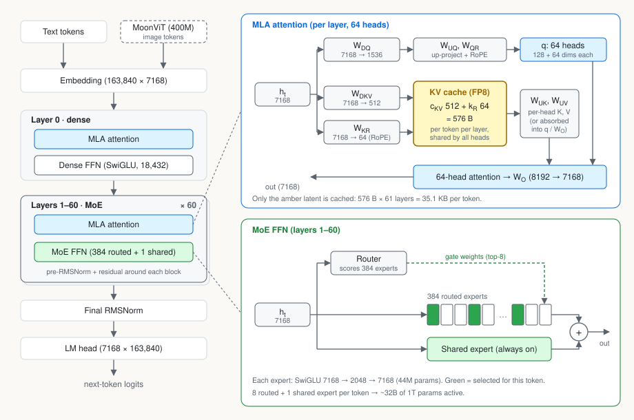

<!-- This post designs a serving system for a 1T-parameter MoE model on one GB300 NVL72 rack, for two workloads: a latency-bound coding agent and offline batch inference. The method is the same for both:

1. Derive a handful of numbers: weight bytes, KV bytes, FLOPs per request, and time per request at effective rates.
2. Find the binding constraint.
3. Pick the architecture, then the parallelism, then size it.
4. Rank the optimizations by how much they move the binding constraint.

All numbers are first-order estimates (±30%). Every one is shown as a formula first, then with numbers plugged in. -->

## Setup

### Model: Kimi K2.6

#### Model architecture

[Kimi K2.6](https://www.kimi.ai/blog/kimi-k2-6) is a decoder-only MoE transformer built on the DeepSeek-V3 layout. Each of its 61 layers has MLA attention and an FFN. The first layer uses a dense FFN, and the other 60 use MoE.

:::muted
Kimi K2.6 architecture.
:::

A 400M-parameter MoonViT vision encoder feeds image tokens into the same decoder. Since the vision encoder is relatively small, this post covers text serving only.

#### Model spec

We use a simplified Kimi K2.6 spec below (all-FP8 weights), while the [official release](https://huggingface.co/moonshotai/Kimi-K2.6) has INT4 experts.

| Field | Value |
|---|---|
| Total params | 1T (FP8) |
| Activated params | 32B / token |
| Layers $L$ | 61 (1 dense + 60 MoE) |
| Experts | 384 total, top-8, 1 shared; expert FFN width $d_\text{ff} = 2048$ |
| Attention | MLA, $d_c = 512$ latent, $d_R = 64$ RoPE, $n_h = 64$ heads |
| Hidden dim $d$ | 7168 (vocab 163,840) |
| KV cache data type | FP8 |
| Max context | 256K |

:::muted
The whole K2 series ([K2-Instruct](https://huggingface.co/moonshotai/Kimi-K2-Instruct), [K2-Thinking](https://huggingface.co/moonshotai/Kimi-K2-Thinking), [K2.5](https://huggingface.co/moonshotai/Kimi-K2.5), K2.6, [K2.7-Code](https://huggingface.co/moonshotai/Kimi-K2.7-Code)) shares the same architecture and config. Only context length, weight precision and K2.5+'s vision encoder differ, so this design applies to all of them.
:::

### Hardware: GB300 NVL72

This rack puts 72 B300 GPUs in a single NVLink domain, so any GPU can reach any other in one hop, which makes communication across them cheap.

| Field | Value |
|---|---|
| GPUs | 72, one NVLink domain |
| HBM | 288 GB / GPU, 8 TB/s |
| NVLink | 1.8 TB/s / GPU bidirectional = 900 GB/s per direction |
| Compute | 5 PFLOP/s dense FP8 (≈2.5 PF dense BF16) |

### Serving scenarios
This post targets two scenarios: coding agent (latency matters more), and batch processing (throughput matters more)

| | Scenario 1: coding agent | Scenario 2: batch |
|---|---|---|
| Input | 100k tokens, 95% prefix-cache hit | 100k tokens, 95% prefix-cache hit |
| Output | 1k tokens | 1k tokens |
| SLO | TTFT ≤ 2 s, ≥ 50 TPS (TPOT ≤ 20 ms), at p99 | none |
| Objective | Max req/s **subject to SLO** | Max req/s |

The two workloads differ only in the SLO. That one difference flips the design.

## Back-of-the-envelope numbers

### Weights

**Min num of GPU to host a complete model**

Hosting one complete copy of the model (1T params, 1 byte each in FP8) takes at least 4 GPUs:

$$
N_\text{min} = \left\lceil \frac{\text{model size}}{M_\text{HBM}} \right\rceil = \left\lceil \frac{1\,\text{TB}}{288\,\text{GB}} \right\rceil = 4
$$

This is an lower bound of num of necessary GPU. In reality, we need more than 4 GPUs because we also need memory space for KV cache, workspace, etc.

**Expert weight vs remaining fixed weight**

In an MoE model, the experts and the rest of the weights could be placed differently (due to expert parallelism), so we need two numbers:

**1. $W_\text{expert}$: size of one expert across all MoE layers.** An expert is a SwiGLU FFN with gate, up and down projections, repeated in each of the 60 MoE layers:

$$
W_\text{expert} = 3\, d\, d_\text{ff} \cdot L_\text{MoE} = 3 \times 7168 \times 2048 \times 60 = 44.0\,\text{M} \times 60 = 2.64\,\text{B} \;\rightarrow\; 2.64\,\text{GB (FP8)}
$$

**2. $W_\text{fixed}$: size of fixed non-expert weights** (everything except the routed experts):

| Part | Formula | Params |
|---|---|---|
| Attention | $(q_a + q_b + kv_a + kv_b + o) \times L = 101\,\text{M} \times 61$ | 6.17 B |
| Shared expert | $44.0\,\text{M} \times 60$ | 2.64 B |
| Embed + LM head | $2 \times 163{,}840 \times 7168$ | 2.35 B |
| Dense FFN (layer 0) | $3 \times 7168 \times 18{,}432$ | 0.40 B |
| **$W_\text{fixed}$** | | **11.6 B ≈ 12 GB** |

:::muted
The per-layer attention term breaks down as $q_a$: $7168{\times}1536$, $q_b$: $1536{\times}(64{\cdot}192)$, $kv_a$: $7168{\times}576$, $kv_b$: $512{\times}(64{\cdot}256)$, $o$: $(64{\cdot}128){\times}7168$. That is $11.0 + 18.9 + 4.1 + 8.4 + 58.7 = 101\,\text{M}$.
:::

These two numbers give the weight on each GPU for any EP layout:

$$
M_\text{weights} = n_\text{slots} \cdot W_\text{expert} + W_\text{fixed} = n_\text{slots} \times 2.64\,\text{GB} + 11.6\,\text{GB}
$$

:::muted
Here $n_\text{slots} = 384 / \text{EP}$ + any redundant expert copies on that rank.
:::

### KV cache size

MLA caches one compressed latent per token per layer: $d_c + d_R$ dims, 1 byte each in FP8.

$$
\text{KV}_\text{token} = (d_c + d_R) \cdot L = (512 + 64) \times 61 = 35.1\,\text{KB}
$$

| Context | Formula | KV / request |
|---|---|---|
| 95k (cached prefix) | $95\text{k} \times 35.1\,\text{KB}$ | 3.3 GB |
| 100k | $100\text{k} \times 35.1\,\text{KB}$ | 3.5 GB |
| 101k (end of decode, used for budgets) | $101\text{k} \times 35.1\,\text{KB}$ | 3.55 GB |

### FLOPs for attention

For one head, each (query, context) pair does a $d_{qk}$-dim dot product (the score) and a $d_v$-dim weighted accumulation (the value), so the cost is $2(d_{qk} + d_v)$ FLOPs per head. MLA can be computed in two mathematically equivalent ways (derivation in [the MLA post](/posts/mla-absorb-proof/)):

| Mode | $d_{qk}$, $d_v$ | Per head | $\times\, n_h = 64$ | $\times\, L = 61$ |
|---|---|---|---|---|
| 1. Naive (Decompress, then MHA) | 192, 128 | $2(192+128) = 640$ | 41 K | 2.5 MFLOP |
| 2. Absorbed (MQA-like) | 576, 512 | $2(576+512) = 2{,}176$ | 139 K | 8.5 MFLOP |

But Mode 1 must first expand each cached latent into per-head K and V:

$$
F_\text{decomp} = 2\, d_c\, n_h\, (d_h + d_v) = 2 \times 512 \times 64 \times (128 + 128) = 16.8\,\text{MFLOP / token / layer}
$$

Which mode is cheaper? For one layer with $q$ query tokens and $N$ cached context tokens:

$$
C_1 = q N \cdot F_\text{Mode 1} + N \cdot F_\text{decomp},
\qquad
C_2 = q N \cdot F_\text{Mode 2}
$$

Setting $C_1 = C_2$ gives the break-even query count. $N$ cancels, so it doesn't depend on context length:

$$
q^* = \frac{F_\text{decomp}}{F_\text{Mode 2} - F_\text{Mode 1}} = \frac{16.8\,\text{M}}{139\,\text{K} - 41\,\text{K}} \approx 170 \text{ query tokens}
$$

- Prefill (5k new tokens, $q \gg q^*$) uses Mode 1.
- Decode (1–2 tokens, $q \ll q^*$) uses Mode 2.

### Per-request FLOP budget

Each token's linear work (all the matmuls outside attention scores) is 2 FLOPs per activated param:

$$
F_\text{linear} = 2 \cdot P_\text{act} = 2 \times 32\,\text{B} = 64\,\text{GFLOP / token}
$$

Context lengths are averaged over each phase. Prefill: $95\text{k} + 5\text{k}/2 = 97.5\text{k}$. Decode: $(100\text{k} + 101\text{k})/2 \approx 100.5\text{k}$.

| Component | Formula | FLOPs | Share |
|---|---|---|---|
| Prefill linear | $5\text{k} \times 64\,\text{G}$ | 0.32 PF | 13% |
| Prefill attention (Mode 1) | $5\text{k} \times 97.5\text{k} \times 2.5\,\text{M}$ | 1.22 PF | 48% |
| Prefill KV decompression | $95\text{k} \times 16.8\,\text{M} \times 61$ | 0.10 PF | 4% |
| *Prefill total* | | *1.64 PF* | *64%* |
| Decode linear | $1\text{k} \times 64\,\text{G}$ | 0.06 PF | 3% |
| Decode attention (Mode 2) | $1\text{k} \times 100.5\text{k} \times 8.5\,\text{M}$ | 0.85 PF | 33% |
| *Decode total* | | *0.92 PF* | *36%* |
| **Total** | | **2.55 PF** | |

:::muted
In actual serving, a prefill sequence could be split into multiple chunks, and prefill is done chunk by chunk (i.e., chunked prefill), to avoid impact from stragglers and to improve throughput.
KV decompression is done per prefill forward pass, so in this case, we need to pay the decompression cost for **every chunk forward pass**. The table above assumes we run KV decompression **only once per request**, which is an simplied estimation.
:::

:::green[Insight]
At 100k context, **~85% of FLOPs are attention** ($48 + 4 + 33$). A 95% cache hit does not make prefill cheap, because the 5k new tokens still attend to ~97.5k of context. Optimizations must target attention.
:::

### Roofline analysis and cost per request

**MFU and MBU**

Real inference doesn't always reach peak, so all timing below assumes 60% MFU and 80% MBU:

$$
F_\text{eff} = 0.6 \times F_\text{peak} = 0.6 \times 5\,\text{PF/s} = 3\,\text{PF/s},
\qquad
BW_\text{eff} = 0.8 \times BW_\text{HBM} = 0.8 \times 8\,\text{TB/s} \approx 6.5\,\text{TB/s}
$$

A step's time is $\max(\text{FLOPs} / F_\text{eff},\; \text{bytes} / BW_\text{eff})$: compute-bound if the first term is larger, memory-bound otherwise.

:::muted
**B300 Roofline ridge point.** Equivalently, a kernel is compute-bound when its arithmetic intensity (FLOP per byte read) exceeds the hardware ridge point:

$$
I_\text{ridge} = \frac{F_\text{peak}}{BW_\text{HBM}} = \frac{5\,\text{PF/s}}{8\,\text{TB/s}} = 625\,\text{FLOP/B},
\qquad
I_\text{ridge}^\text{eff} = \frac{F_\text{eff}}{BW_\text{eff}} = \frac{3\,\text{PF/s}}{6.5\,\text{TB/s}} \approx 462\,\text{FLOP/B}
$$
:::

**Prefill cost per request**

Prefill needs to run FLOPs, collective communication and memory IO, but its FLOP compute takes most of the time (i.e., compute-bound), so we estimate its cost with the FLOPs.

$$
t_\text{prefill} = \frac{F_\text{attn} + F_\text{linear} + F_\text{decomp}}{3\,\text{PF/s}} = \frac{1.22 + 0.32 + 0.10}{3} = 0.41 + 0.11 + 0.03 \approx 0.55\,\text{GPU·s}
$$

That is $\approx 0.11$ ms per new token.

**Decode attention cost per request per step** (Mode 2)

$$
t_\text{mem} = \frac{\text{KV}}{BW} = \frac{3.5\,\text{GB}}{6.5\,\text{TB/s}} = 0.54\,\text{ms},
\qquad
t_\text{comp} = \frac{100.5\text{k} \times 8.5\,\text{M}}{3\,\text{PF/s}} = 0.285\,\text{ms}
$$

$$
t_\text{decode} = \max(t_\text{mem}, t_\text{comp}) = 0.54\,\text{ms} \text{ (memory-bound)}
$$

This is not a complete time cost of a decode step per request, because each decode step also reads the model weights. How many bytes to read depends on parallelism and sharding, which we work out later.

**Rack ceiling** (compute-only upper bound):

$$
\lambda_\text{max} = \frac{N_\text{GPU} \cdot F_\text{eff}}{F_\text{request}} = \frac{72 \times 3\,\text{PF/s}}{2.55\,\text{PF}} \approx 85\,\text{req/s}
$$

:::muted
This is an upper bound because FLOPs set a floor on time: no request can finish in less than $2.55\,\text{PF} / 3\,\text{PF/s} = 0.85$ GPU·s. It is reachable only if all memory traffic hides under compute, e.g. decode's KV reads overlapping with prefill on the same GPU. 
:::

## Scenario 1: latency-bound (coding agent)

### Binding constraint

$$
\text{TPOT} \le \frac{1}{50\,\text{TPS}} = 20\,\text{ms}
\qquad\Rightarrow\qquad
T_\text{step} \le 20\,\text{ms}
$$

Without speculative decoding, each decode step emits one token, so a step must finish within 20 ms. TTFT ≤ 2 s and TPOT must both hold at **p99**, which favors designs that keep prefill and decode from interfering.

### Deployment setup: disaggregated vs aggregated

There are two options:

- **Aggregated serving:** one step has both prefill tokens and decode tokens (a.k.a. chunked prefill).
- **Disaggregated serving:** separate GPU pools for prefill and decode, with the KV cache handed off between them.

We prefer disaggregated serving for this scenario, for the following reasons:

**1. Aggregated serving can't guarantee tail latency**

In an aggregated serving setup, prefill and decode share the same forward step, so a load spike in one phase shows up as a latency spike in the other.

| Interference | What happens | Impact |
|---|---|---|
| **Prefill → decode** | A large prefill chunk (a burst of arrivals, a cold prompt) makes the step longer, and every decode stream on that GPU waits for it | p99 TPOT jumps |
| **Decode → prefill** | Decode work comes first in each 20 ms step, so prefill only gets what is left. When decode load rises (more streams, longer contexts), prefill slows down and queues build | p99 TTFT jumps |
| **EP sync spreads it rack-wide** | With EP72, all 72 GPUs sync at every MoE layer, so a step is as slow as its slowest GPU. If each GPU has a 1% chance of a spike per step, $1 - (1 - 1\%)^{72} \approx 52\%$ of steps are slow, for every stream | rare spikes become common |
| **No chunk size protects both** | Capping the prefill chunk protects TPOT but pushes bursts onto TTFT; not capping it does the opposite. A cold first turn (6.3 GPU·s of prefill) shows the extreme: it ties up a GPU's prefill share for seconds, delaying warm requests cached there | TTFT or TPOT must slip |

Disaggregation removes the coupling: decode steps contain no prefill, so TPOT is stable, prefill variance stays within a prefill pool, and cold prompts get their own queue (with CP).

**2. KV cache transfer is cheap inside this large NVLink domain** 

The only extra work from disaggregated serving, is moving each request's KV from the prefill pool to the decode pool:

$$
t_\text{handoff} = \frac{\text{KV}}{BW_\text{NVLink}} = \frac{3.5\,\text{GB}}{900\,\text{GB/s}} \approx 4\,\text{ms}
$$

That is under 1% of a 0.55 s prefill, and layer-wise streaming hides it anyway. Disaggregation's real risk is a mismatched P:D split, which is handled by sizing (below) and an elastic planner.

**3. Each pool can use the kernels that suit it**

Decode runs small, fixed-shape steps, so it wants CUDA graphs and DeepEP's low-latency all-to-all. Prefill runs large, variable-shape batches, so it wants DeepEP's normal mode. An aggregated step mixes both and has to compromise, which makes every step slower. Disaggregation lets each pool run its own kernels.

:::blue[Decision]
**PD-disaggregated inside the NVLink domain.** It keeps both p99 TTFT and p99 TPOT within the SLO.
:::

### Prefill pool

#### Parallelism choice

| Layer part | Option | Tradeoff | Analysis | Decision |
|---|---|---|---|---|
| Attention | DP | **+** no attention comm, KV stored once · **−** fixed weights replicated on every GPU | One GPU already meets TTFT (0.55 s vs 2 s), so pick the highest-throughput option: no comm, no duplicate KV | ✓ |
| | TP | **+** lower latency for one request · **−** KV replicated on every rank, all-reduce per layer | Buys latency we don't need, and pays for it in throughput (all-reduce) and prefix-cache capacity (duplicate KV) | ✗ |
| | CP | **+** lower latency for one request, KV stays sharded · **−** KV blocks circulate between GPUs | Needed only when one GPU can't meet TTFT: cold prompts (100k uncached) | cold prompts only |
| MoE | EP | **+** weights per GPU shrink, full-width GEMMs · **−** token all-to-all | Required to fit the 1 TB of experts; its all-to-all is small next to prefill compute | ✓ |
| | TP on experts | **+** same memory cut as EP · **−** narrow GEMMs, extra all-reduce | Same memory saving as EP with more comm and slower GEMMs: no upside | ✗ |
| Whole model | PP | **+** shrinks weights, little communication · **−** pipeline bubble, a hop per stage | Adds latency to TTFT, and EP already makes the model fit | ✗ |

#### Parallelism degree

**EP degree**

Prefill is compute-bound, so pick the smallest EP that fits in memory. That keeps the sync and failure domain small.

$$
M_\text{weights} = \frac{384}{\text{EP}} \cdot W_\text{expert} + W_\text{fixed}
$$

- EP4: $96 \times 2.64 + 11.6 = 253 + 11.6 \approx 265\,\text{GB}$. Only 23 GB left for activations and KV. ✗
- EP8: $48 \times 2.64 + 11.6 = 127 + 11.6 \approx 138\,\text{GB}$. That leaves 150 GB; after ~30 GB of activations and in-flight KV, ~120 GB is free for prefix cache. ✓

:::muted
**Why not a wider EP?** A wider EP adds GPUs, but under DP-attention each added GPU also brings its own prefill requests. Prefill tokens per GPU stay the same, so the expert work per GPU, and the prefill time, does not drop. A wider EP only makes the sync and failure domain bigger.
:::

All-to-all is not a concern in this large NVL domain. Each token sends $k$ FP8 copies of its hidden state out and gets $k$ BF16 copies back:

$$
\text{bytes/token/layer} = k \cdot d \cdot (1 + 2) = 8 \times 7168 \times 3 \approx 172\,\text{KB}
$$

$$
BW = \frac{172\,\text{KB} \times 60 \times 5\text{k}}{0.55\,\text{s}} = \frac{51.6\,\text{GB}}{0.55\,\text{s}} \approx 94\,\text{GB/s} \approx 10\% \text{ of NVLink}
$$

**DP-attention degree**

DP-attention uses the same degree as EP, so DP 8. Every GPU in an instance runs both attention and experts, so no GPU idles in either half of a layer.

:::muted
**What if DP ≠ EP?**
- **DP4 + EP8:** each attention group spans 2 GPUs, so attention becomes DP4 × TP2. TTFT roughly halves, but each layer adds an all-reduce, and every prefix is stored on both GPUs, halving the HBM prefix cache. That is the TP fallback, not needed while TTFT fits.
- **DP16 + EP8:** 16 GPUs with experts split only 8 ways, so every expert is stored twice: 127 GB of experts per GPU instead of 63 GB at EP16, with no speedup. It is two EP8 instances in one bigger sync domain; two separate instances are strictly better.
:::

**CP degree for cold prompts:** CP8, i.e. one cold request spread over a whole EP8 instance (sized under Estimated perf).

### Decode pool

#### Parallelism choice

Decode is memory-bound under a 20 ms step. Per step, each GPU reads (a) the KV of every request it serves and (b) its share of the weights, so the goal is to minimize bytes read per GPU per step.

| Layer part | Option | Tradeoff | Analysis | Decision |
|---|---|---|---|---|
| Attention | DP | **+** no attention comm, KV stored once · **−** fixed weights replicated on every GPU | KV reads are the bottleneck: DP reads each request's KV on exactly one GPU and keeps full KV capacity for the batch | ✓ |
| | TP | **+** lower latency for one request · **−** KV replicated on every rank, all-reduce per layer | Doesn't cut KV reads per GPU (the latent can't be split), so no speedup on the bottleneck, and it divides KV capacity, i.e. the batch | ✗ |
| | CP | **+** each GPU reads part of one request's KV · **−** cross-GPU attention traffic | Helps only when one request's KV read is a big part of the step; at ≤ 256K it is ~1.4 ms of a 20 ms step | ✗ |
| MoE | EP | **+** fewer weight bytes per GPU · **−** token all-to-all | Weight reads are the other per-step cost; EP cuts them as 1/EP, shortening every step | ✓ |
| | TP on experts | **+** same bytes cut as EP · **−** narrow GEMMs, extra all-reduce | Cuts the same bytes as EP but adds an all-reduce on the latency-critical path | ✗ |
| Whole model | PP | **+** shrinks weights, little communication · **−** pipeline bubble, a hop per stage | Every token crosses all stages, adding hop latency to TPOT; EP cuts weight bytes without it | ✗ |

#### Parallelism degree

To maximize throughput, decode runs the largest batch that fits the step budget. At that batch, every expert gets tokens every step, so each GPU reads all of its local experts. Even 10 streams on each of 32 GPUs leaves almost no expert idle:

$$
P(\text{an expert gets no token}) = \left(1 - \frac{k}{N_{experts}}\right)^{B \cdot N_{gpu}} = \left(1 - \frac{8}{384}\right)^{4 \times 40} \approx 3.4\%
$$

:::muted
**Why not run a tiny batch to load fewer experts?** It works, but with a price of a lower throughput. At $B = 1$ on EP40, the step time drops to ~6.3 ms, but each GPU then makes ~158 tok/s instead of ~1,000. The SLO only needs step time under 20 ms, so the goal is the largest batch that fits, and at that batch every expert is hit.
:::

Per step, each decode GPU reads (a) the KV of every request it serves and (b) its share of the weights. Under a 20 ms budget, this fixed weight read directly limits the batch:

$$
T_\text{step} = \underbrace{t_\text{weights}(\text{EP})}_\text{weights} + \underbrace{B \times 0.54\,\text{ms}}_\text{KV cache} + \underbrace{1.5\,\text{ms}}_\text{comm + launch},
\qquad
t_\text{weights} = \frac{n_\text{slots} \times 2.64\,\text{GB} + 11.6\,\text{GB}}{6.5\,\text{TB/s}}
$$

Solve for the batch at a 17 ms target step (15% headroom under 20 ms), then the decode cost per request, $\text{GPU·s}_D = 17\,\text{s} / B$ (1k steps × 17 ms, shared by $B$ streams):

| EP | Slots/GPU | Bytes/step | $t_\text{weights}$ | $B = \frac{17 - \text{fixed}}{0.54}$ | $\text{GPU·s}_D$ |
|---|---|---|---|---|---|
| 8 | 48 | $48 \times 2.64 + 11.6 = 138$ GB | 21 ms | — | exceeds 20 ms alone |
| 24 | 16 + 1 | $17 \times 2.64 + 11.6 = 56$ GB | 8.7 ms | 12.6 | 1.35 |
| 32 | 12 + 2 | $14 \times 2.64 + 11.6 = 49$ GB | 7.5 ms | 14.9 | 1.14 |
| 40 | 9.6 + 1.4 | $11 \times 2.64 + 11.6 = 41$ GB | 6.2 ms | 17.1 | 0.99 |
| 48 | 8 + 1 | $9 \times 2.64 + 11.6 = 35$ GB | 5.4 ms | 18.6 | 0.91 |
| 72 | 5.3 + 0.7 | $6 \times 2.64 + 11.6 = 27$ GB | 4.2 ms | 20.9 | 0.81 (no GPUs left for prefill) |

Wider EP makes decode cheaper but leaves fewer GPUs for prefill. So the decode EP degree is picked together with the P:D split, in Sizing.

### Sizing

**P : D split.** Prefill must come in whole EP8 instances (multiples of 8 GPUs), and the decode pool takes the rest as one EP instance, with its batch $B$ from the EP table above. Each pool's capacity:

$$
\lambda_P = \frac{P}{t_\text{prefill}} \times 0.7 = \frac{P\,[\text{GPU}]}{0.55\,[\text{GPU·s/req}]} \times 0.7
$$

$$
\lambda_D = \frac{D \cdot B\,[\text{req in flight}]}{t_\text{gen}\,[\text{s}]},\quad t_\text{gen} = 1000 \text{ tokens} \times 17\,\text{ms} = 17\,\text{s}
$$

:::muted
A pool's capacity is the request rate it can sustain without its queue growing. The 0.7 caps prefill at 70% utilization to leave TTFT headroom for queueing.
:::

The rack capacity is then $\lambda = \min(\lambda_P, \lambda_D)$:

| Split | Decode EP, $B$ | Prefill cap | Decode cap | Rack |
|---|---|---|---|---|
| 24 P / 48 D | EP48, 18 | 31 | 52 | 31 (prefill-bound) |
| **32 P / 40 D** | **EP40, 17** | **41** | **40** | **40** |
| 40 P / 32 D | EP32, 15 | 51 | 28 | 28 (decode-bound) |
| 48 P / 24 D | EP24, 12 | 61 | 17 | 17 (decode-bound) |

32 P / 40 D balances the two pools. EP40's $40 \times 11 = 440$ expert slots hold all 384 experts plus 56 redundant copies for load balancing (EPLB).

**Memory check:**

$$
M = B \cdot \text{KV} + W + \text{workspace} = 17 \times 3.55 + 41 + 20 \approx 121\,\text{GB} \le 288 \;\checkmark
$$

That leaves ~167 GB spare per GPU for the HBM prefix-cache tier.

**All-to-all per step:**

$$
B \times 60 \times 172\,\text{KB} = 17 \times 60 \times 172\,\text{KB} \approx 0.18\,\text{GB} \;\rightarrow\; 0.2\,\text{ms, hidden by two-batch overlap}
$$

:::blue[Decision]
**32 prefill (4 × EP8) + 40 decode (1 × EP40), batch 17 per decode GPU.** The two pools are balanced at ~40 req/s.
:::

### Estimated perf

**Prefill pool:**

| Metric | Formula | Value |
|---|---|---|
| Prefix fetch | 3.3 GB for the 95k prefix, from HBM: $3.3\,\text{GB} / 900\,\text{GB/s}$ | ~4 ms |
| Prefill compute | $0.41 + 0.11 + 0.03$ | ~0.55 s |
| KV handoff | $3.5\,\text{GB} / 900\,\text{GB/s}$, mostly overlapped | ~4 ms |
| Queueing at $\rho = 0.7$ | 32 parallel servers, Erlang-C wait probability ~10%; dominant wait is the next forward-pass boundary (1–2k-token chunks) | 0–0.3 s |
| **TTFT, warm** | sum of the above | **≈ 0.6–0.9 s** ✓ |
| **Request throughput** | $\frac{32\,\text{GPU}}{0.55\,\text{GPU·s/req}} \times 0.7$ | **~41 req/s** |
| Input token throughput | $41\,\text{req/s} \times 5\text{k} / 32\,\text{GPU}$ | ~6.4k tok/s/GPU (~9.1k while busy) |

:::muted
**What if there are cold prompts?** A cold first turn has all 100k tokens uncached. Each new token attends to every earlier one ($N^2/2$ pairs at 2.5 MFLOP), plus 64 GFLOP of linear work per token:

$$
t_\text{attn} = \frac{N^2/2 \cdot F_\text{Mode 1}}{F_\text{eff}} = \frac{(100\text{k})^2 / 2 \times 2.5\,\text{M}}{3\,\text{PF/s}} = \frac{1.25 \times 10^{16}}{3 \times 10^{15}} \approx 4.2\,\text{s}
$$

$$
t_\text{linear} = \frac{N \cdot F_\text{linear}}{F_\text{eff}} = \frac{100\text{k} \times 64\,\text{G}}{3\,\text{PF/s}} = \frac{6.4 \times 10^{15}}{3 \times 10^{15}} \approx 2.1\,\text{s}
$$

That is 6.3 GPU·s, over the 2s TTFT on one GPU. We can use CP to reduce the latency with more GPU. Assuming we go with CP8, the latency will then be $6.3 / 8 \approx 0.8\text{–}1.0$ s. We can make one of the four prefill instances CP8 + EP8 for cold prompts, while the other three remain DP8 + EP8 for warm prompts.
:::

**Decode pool:**

| Metric | Formula | Value |
|---|---|---|
| Weight read | $41\,\text{GB} / 6.5\,\text{TB/s}$ (EP40) | 6.2 ms |
| KV reads | $17 \times 0.54\,\text{ms}$ | 9.2 ms |
| Comm + launch | exposed overhead | 1.5 ms |
| **TPOT** | sum of the above | **≈ 17 ms** ✓ (≤ 20 ms) |
| Per-stream speed | $1 / 17\,\text{ms}$ | ~59 TPS |
| **Request throughput** | $\frac{40 \times 17\,\text{req in flight}}{17\,\text{s}}$ | **~40 req/s** |
| Output token throughput | $40\,\text{req/s} \times 1\text{k} / 40\,\text{GPU}$ | ~1,000 tok/s/GPU |

**Rack:**

| Metric | Formula | Value |
|---|---|---|
| **Goodput** (req/s within SLO) | $\min(\lambda_P, \lambda_D) = \min(41, 40)$ | **~40 req/s ≈ 40k output tok/s** |
| vs compute ceiling | $40 / 85$ | ~47% |

### Further optimizations

There are further optimizations for this scenario:

1. **Speculative decoding.** The criterion is simple: use it only if tokens emitted per step grow faster than the step time. 

   Whether that holds depends on the acceptance rate, the draft model's cost, whether the target model's attention and MoE stay memory-bound with the extra tokens, etc.

   Actual serving frameworks benchmark a few runs (with and without a draft, at different draft lengths) on representative traffic, and then decides whichever the best config for speculative decoding.

2. **KV offloading + cache-aware routing.** The 95% hit rate requires each session's KV to survive between turns. Keep it in spare HBM and offload the overflow to Grace memory (17 TB), and route each turn to the instance that holds its prefix.

3. **Balance DP-attention ranks by total context, not request count.** A rank's attention time scales with the KV it reads, and the slowest rank sets every step. So the router should place requests by their context length, which also absorbs long-context (up to 256K) requests without special parallelism.

4. **Lower-precision experts (NVFP4 / INT4).** Expert weights are most of the bytes each decode step reads, so halving their precision shortens every step and allows a bigger batch. The cost is accuracy risk, which the released K2.6 avoids by shipping INT4 experts trained for it.

## Scenario 2: throughput-bound (batch)

### Binding constraint

No SLO. The objective is req/s per rack, which means keeping **both** bottleneck resources busy at once: tensor cores (prefill) and HBM bandwidth (decode attention). The binding resources are attention compute and KV capacity.

### Deployment setup: aggregated vs disaggregated

The reasons for disaggregation disappear. Longer steps and TTFT don't matter, and stragglers cost a few percent of throughput instead of an SLO violation. Aggregation then wins:

- **No ratio guessing.** A fixed P:D split idles one side whenever the traffic mix drifts. Aggregation self-balances, and there is no KV handoff.
- **Complementary resources.** Decode attention is memory-bound (0.54 ms of KV reads vs 0.285 ms of math per request per step), so it leaves compute idle, and prefill fills it. Prefill MoE tokens also ride on expert weights that decode is already reading.
- **No CP needed.** A cold prompt just takes more chunks on its rank.

:::blue[Decision]
**One aggregated instance with chunked prefill mixed into every decode step.**
:::

### Parallelism

Every byte of weights on a GPU is a byte not available for KV, and communication hides under a long step. So minimize weight memory per GPU and never replicate KV.

$$
W_\text{GPU} = \frac{384 + 48}{72} \times 2.64 + 11.6 = 6 \times 2.64 + 11.6 \approx 27.5\,\text{GB}
\;\rightarrow\; t_\text{weights} = \frac{27.5}{6.5\,\text{TB/s}} \approx 4.2\,\text{ms}
$$

$$
B_\text{max} = \frac{288 - W_\text{GPU} - \text{workspace}}{\text{KV}} = \frac{288 - 27.5 - 25}{3.55} \approx 66 \text{ streams/GPU}
$$

| Option | Analysis | Decision |
|---|---|---|
| **DP-attn 72** | KV stored once, no attention comm, ~66 streams capacity | ✓ |
| TP | Replicates the latent: TP8 cuts capacity 66 → ~8 streams | ✗ |
| CP | Only lowers single-request latency, which has no value here | ✗ |
| **EP 72** | Smallest weights (27.5 vs 41 GB at EP40), so ~4 more streams/GPU | ✓ |
| 2 × EP36 | 43 GB/GPU → ~62 streams, about −5%; halves the failure domain | alternative if fault isolation matters |
| TP on experts / PP | Same reasons as scenario 1 | ✗ |

### Sizing

Target 75 req/s, solve for the step time $T$, then check concurrency against KV capacity.

$$
r_\text{prefill} = \frac{\lambda \times 5\text{k}}{72} = \frac{75 \times 5\text{k}}{72} \approx 5.2\text{k tok/s/GPU}
$$

Decode uses draft-1 speculation (see scenario 1, optimization 1), so each request costs $\max(0.54,\; 2 \times 0.285) = 0.57$ ms per step. Per step, each GPU spends fixed + decode + prefill time:

$$
T = \underbrace{7}_\text{4.2 weights + 3 comm} + \underbrace{B \times 0.57}_{B \approx 60 \;\rightarrow\; 34} + \underbrace{r_\text{prefill}\, T \times 0.11\,\text{ms}}_{0.57\,T}
\;\Rightarrow\;
T = \frac{7 + 34}{1 - 0.57} \approx 95\,\text{ms}
$$

$$
\text{prefill chunk} = 5.2\text{k} \times 0.095 \approx 500 \text{ tok/rank/step},
\qquad
\text{TPS} = \frac{1.7}{0.095} \approx 18 \;\rightarrow\; t_\text{gen} \approx 56\,\text{s}
$$

**Little's law check:**

$$
N = \lambda \cdot t_\text{gen} = 75 \times 56 \approx 4.2\text{k streams} = 72 \times 58/\text{GPU} \le 66 \;\checkmark
$$

**All-to-all:** $(58 \times 2 + 500) \approx 620$ tok $\times\, 60 \times 172\,\text{KB} \approx 6.4\,\text{GB}$, which takes ~7 ms. That is well under the 95 ms step and hidden by two-batch overlap.

**Cross-check by GPU time per request:**

$$
\text{GPU·s} = \underbrace{0.55}_\text{prefill} + \underbrace{588 \times 0.57\,\text{ms}}_\text{decode attn = 0.33} + \underbrace{588 \times \frac{7\,\text{ms}}{58}}_\text{fixed = 0.07} \approx 0.95
\;\Rightarrow\;
\lambda = \frac{72}{0.95} \approx 76\,\text{req/s} \;\checkmark
$$

Here $588 = 1000 / 1.7$ decode steps.

### Estimated perf

| Metric | Value |
|---|---|
| Rack throughput | **~76 req/s ≈ 76k output tok/s** |
| vs ceiling | $76 / 85 \approx 89\%$ |
| vs scenario 1 | $76 / 40 \approx 1.9\times$ |
| Step time | ~95 ms |
| Per-stream speed | ~18 TPS (irrelevant) |

:::muted
**Why only 1.9×, not the 5–10× typical at short context?** Batching only amortizes weight reads, which all requests in a step share. Here ~85% of the cost is attention, which belongs to each request and grows with its own context. Scenario 1 loses mainly to the 70% prefill cap (0.79 vs 0.55 GPU·s), a much smaller decode batch (17 vs 58), which amortizes the fixed cost less well, and no speculation.
:::

### Optimizations

1. **Speculative decoding with draft 1, even at large batch.** This is counterintuitive: in short-context serving, big batches make decode compute-bound and speculation wastes FLOPs. Here decode attention is still memory-bound at $q = 1$.

   | Decode mode | GPU·s / request | Rack req/s |
   |---|---|---|
   | $q = 1$ | $0.55 + 1\text{k} \times 0.54\,\text{ms} + 1\text{k} \times 7/58\,\text{ms} = 1.21$ | ~60 |
   | **$q = 2$, $a = 1.7$** | $0.55 + 0.33 + 0.07 = 0.95$ | **~76** |
   | Perfect P/D overlap (decode KV reads hidden under prefill compute) | $0.55 + 0.28 + 0.02 + 0.02 = 0.87$ | ~83 |

   Speculation is worth about +25%. If kernels can truly overlap decode attention with prefill (POD-attention, SM partitioning), prefill already fills the idle compute and speculation's extra benefit shrinks.

2. **FP8 attention is the main lever.** Attention is ~85% of FLOPs, so each 10% gained on attention kernels is ≈ 8.5% end to end.

3. **Cache-aware scheduling + Grace offload.** Batch jobs can be reordered freely, so run each session's turns back-to-back on the same DP rank and keep its prefix in HBM. Park sessions waiting on tools in Grace: $17\,\text{TB} / 3.55\,\text{GB} \approx 4.8\text{k}$ parked sessions, on top of 4.2k active. Admission control caps sessions at that capacity so the hit rate stays ≥ 95%.

4. **EPLB (48 redundant slots), DeepEP, and DP-attention balancing by $\sum$ context.** Balancing matters more here: 58 requests per rank, plus ~500-token prefill chunks with varying context.

5. **NVFP4 experts: ≤ ~8%.** They touch only ~10% of FLOPs, plus a 4.2 ms weight read per 95 ms step.

## Comparison

| Dimension | Scenario 1: coding agent | Scenario 2: batch |
|---|---|---|
| Binding constraint | TTFT (prefill queueing) + TPOT (step ≤ 20 ms) | Attention compute + KV capacity |
| Deployment setup | PD-disaggregated, 32 P / 40 D | Aggregated, chunked prefill |
| Attention parallelism | DP (+ CP 8 for cold prefill) | DP |
| EP degree | 8 prefill (smallest that fits), 40 decode (weight read vs P:D balance) | 72 (max KV capacity) |
| Batch / decode GPU | 17 (step-time bound) | ~58 (Little's law, ≤ 66) |
| Step time | ~17 ms | ~95 ms |
| Spec decoding | None in the base design (an optimization) | Draft 1 |
| Throughput | ~40 req/s | ~76 req/s |
| % of 85 req/s ceiling | ~47% | ~89% |

The same model on the same hardware leads to opposite architectures, because the binding constraint differs. Scenario 1 gives up about half of its throughput to bound TTFT and TPOT.

## Assumptions and difference

- **Efficiency:** 60% of peak FLOPs, 80% of HBM bandwidth, and FlashMLA-class FP8 attention kernels.
- **Speculation:** ~1.7 accepted tokens per step at draft 1 (scenario 1's optimization and scenario 2) is plausible for code; measure it on real traces. Agent think time between turns is assumed to be ~30 s.
- **Cache hit:** "95%" is read as a per-token average across turns. Cold first turns are handled by CP 8.
- **Head count matters:** with 128 heads (as in DeepSeek-V3), decode attention math doubles to 0.57 ms per request per step, above the 0.54 ms KV read. Attention would then be compute-bound at $q = 1$ and speculation would gain little.
- **Released K2.6 vs the spec used here.** None of these change the design decisions:
  - Routed experts are native INT4 and the rest is BF16, so the checkpoint is ≈ 595 GB, not 1 TB. The EP40 decode weight read becomes ~38 vs 41 GB. EP4 prefill would now fit, but EP8 is still preferred.
  - FP8 KV is an engine choice. Real layouts often keep RoPE in BF16 plus scales (~576–656 B/token/layer), so expect ~10–15% fewer streams per GPU.
- **Tuning:** tune the P:D ratio, batch size, chunk budget and draft length by profiling production traffic.
