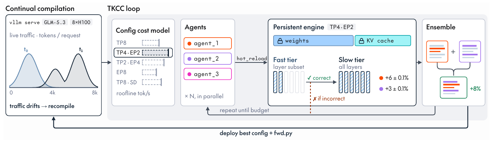
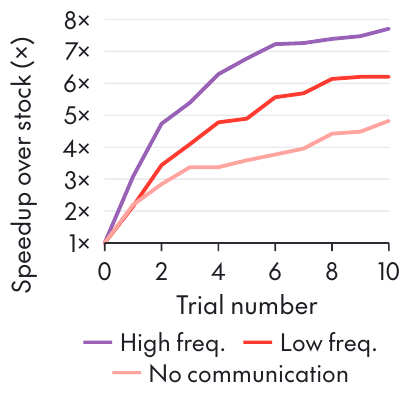
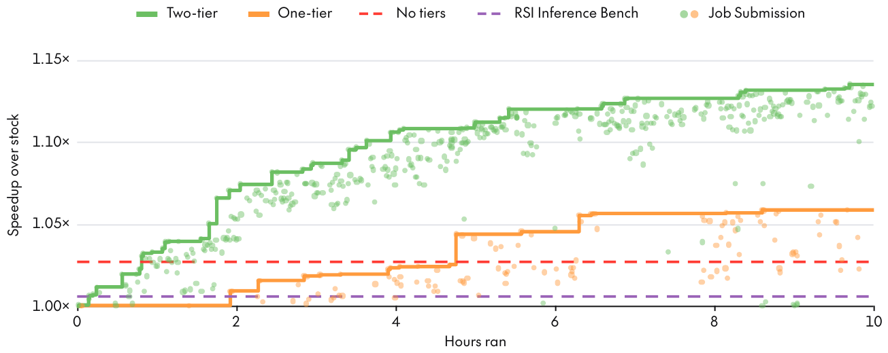
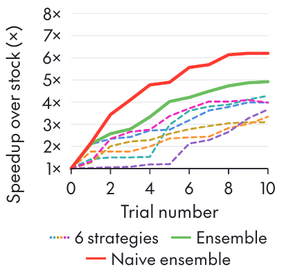
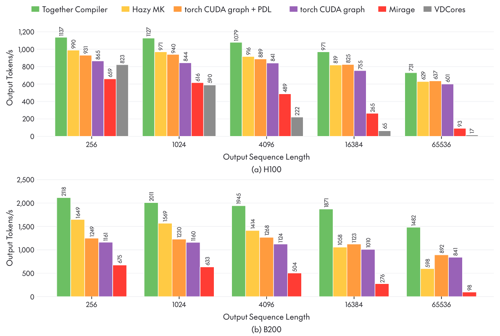
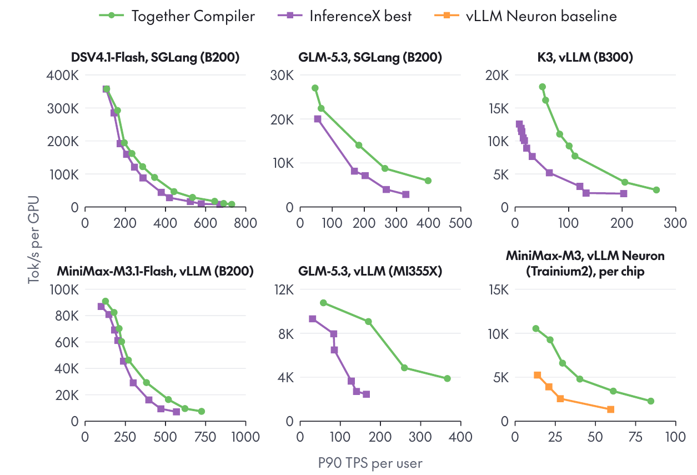
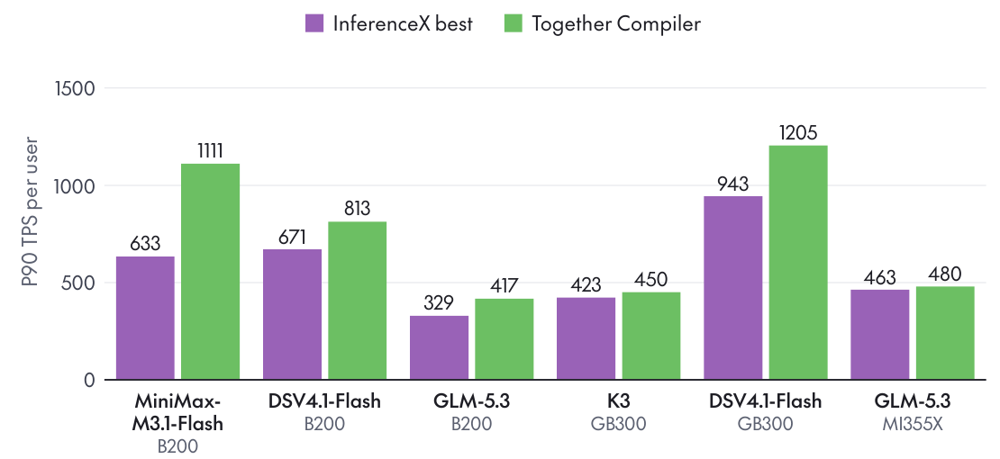
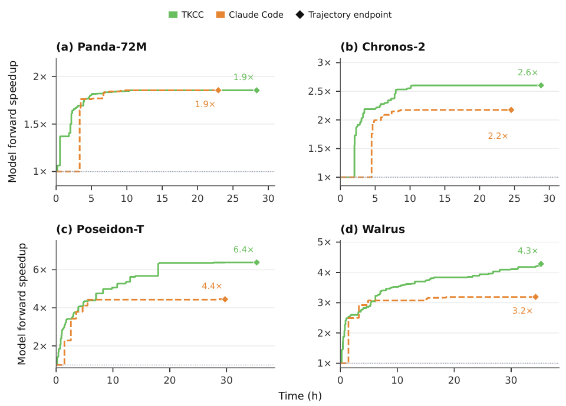
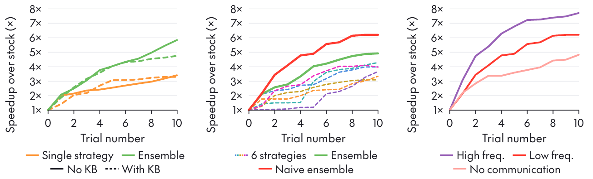

[Together Compiler](https://www.alphaxiv.org/abs/2611.together-compiler-continual-ai-inference) (TKCC) is an agent loop from together.ai, to continually adapt their inference engine to changing inference traffic. They achieved SOTA serving perf from this TKCC across models and hardware, and they are using it in their prod env. ([blog](https://www.together.ai/blog/together-compiler-continual-compilation-for-ai-inference), [paper](https://www.alphaxiv.org/pdf/2611.together-compiler-continual-ai-inference))

Inference engine optimization depends on 3 inputs: **workload, model, and hardware**. Since new models and hardware arrive every year, and workloads change across use cases, it is not scalable to tune each combination by hand.

Agents are a great fit for this problem, but a simple use of agents can take a lot of hardware and time (because of the large search space), and still relies on human experts for review.

TKCC is together's answer here, to accelerate this automatic optimization, and make it truly continual. Their bitter lessons are also worth a read!


## System overview

:::wide

:::

:::muted
Overview of TKCC from their paper
:::

They monitor live traffic, and when the traffic drifts, it triggers a TKCC loop which contains 4 main components:

1. **Config cost model:** It comes up with potential parallelism configs, ranks them by estimated throughput, and returns the top-k configs.
2. **Agents:** Several agents work in parallel, share progress on a message board to avoid duplicate work, and each submits its own optimization candidate.
3. **Persistent engine:** It loads weights once and hot-reloads each candidate. A fast tier engine for high-throughput iteration and a slow tier engine for high-fidelity signal.
4. **Ensemble:** It combines the wins from different agents, then loops back to Step 2 until the perf target is met. Once the target is met, it deploys to prod.


## 1. Proposing parallelism configs with a cost model
This stage constructs a search space for all possible parallelism configs, prune the search space, calibrate a cost model with low-level measurements, and then estimate high-level throughput for each config and return the top-k configs.

A cost model is just a math modeling to estimate the throughput for a parallelism config.

### 1.1 Build a search space
The search space considers GPU sizes from one to a fixed maximum number of chips (e.g., 4096). They collect all combinations across: 
- MoE: Expert Parallel (EP), Tensor Parallel (TP)
- Dense: Tensor Parallel
- Attention: Tensor Parallel, Data Parallel (DP), Context Parallel (CP)

### 1.2 Prune the search space
A parallelism config is dropped if:
- it can not fit the model weights or evenly divide any of the model’s tensor dimension, or
- it can not meet a fixed prefill time-to-first-token (TTFT) and decode TPS SLA.

### 1.3 Calibrate with tiered measurements

A cost model depends on some parameters to estimate throughput for a parallelism config. There are two types of parameters:
- hardware parameters: HBM bandwidth, FLOPs, collective commuincation latency, etc. 
- workload parameters: expert-activation skew, MTP acceptance rates, prompt length distribution, etc.

They collect values for those parameters from 3 sources below, and they provide 3 levels of estimation from each source.
- hardware spec
- measured compute / memory / collective microbenchmarks
- measured end-to-end forward pass

Those 3 levels of estimate can let them find optimization opportunties that are hidden by current poor software implementation. For example, a low throughput estimation from E2E forward pass measurement but a high throughput estimation from microbenchmark measurements, could be a signal for such case.


### 1.4 Rank by estimated throughput
They build a cost model to estimate throughput in 4 steps
1. estimate the step time: max(compute time, memory IO time) + communication time (compute and memory overlap; communication doesn't)
2. estimate the max batch size based on memory limitation and latency requirement
3. estimate the GPU cost (GPU*sec per request) for prefill and decode separately, assuming disaggregated inference
4. estimate the overall throughput (tokens/min per chip) based on sequence length and GPU cost


## 2. Agents
Each agent optimizes the model's forward pass in a file `tkcc_forward.py`, and when it is done, it submit that file to the persistent engines for evaluation. Check the 3.1 hot-reloading below for more details.

Agents also communicate with a message board, so they don't repeat each other's work. The more often they talk, the faster the speedup climbs:



:::muted
Paper Figure 5c: MiniMax-M3 layer 3, B200 TP4, batch size 1, TensorRT-LLM.
:::
After 10 trials, frequent communication reaches ~7.7× over stock, vs. ~4.8× with none.


## 3. Persistent engines and hot reloading

### 3.1 Hot reloading
Optimizations from different agents share the same model and parallelism config, so we can just update engines' forward pass with a hot reload, to reduce swapping overhead.

```python
# Agent side: write tkcc_forward.py, then submit it as a job
def forward(model, input_ids, positions):
    return optimized_forward(model, input_ids, positions)

post_rpc(engine, "hot_reload", file="tkcc_forward.py")
result = measure(engine)
post_rpc(engine, "teardown")

# Engine side, on every rank
def hot_reload(file):
    write("/tmp/forward.py", file)
    candidate = exec_file("/tmp/forward.py")
    baseline = model.forward
    model.forward = candidate.forward     # patch the function pointer
    recapture_cuda_graphs()

def teardown():
    restore(model, baseline)              # unload kernel modules
    recapture_cuda_graphs()
```

:::muted
Code snippet from their paper
:::

### 3.2 persistent engines

Most of an engine's startup has nothing to do with the forward pass being tested:

| Phase | Status quo (s) | Together Compiler (s) |
|---|---|---|
| Process + worker init | 93 | – |
| Weight loading | 50 | – |
| KV-cache sizing | 21 | – |
| JIT kernel warm-up | 93 | – |
| Autotuning | 193 | – |
| API server ready | 10 | – |
| RPC call + TKCC setup | – | 1.7 |
| CUDA-graph capture | 7 | 7.3 |
| **Total time to serving** | **467** | **9.0** |

:::muted
Table 1 from the Together AI blog post.
:::

Restarting the engine costs 467 s per experiment, almost all of it on init, weights, warm-up, and autotuning. A persistent engine pays those once and leaves only what depends on the candidate: loading the new code and re-capturing CUDA graphs. That takes **9 s, about 52× faster**.


Two caches cut each measurement further:

- **Prefix-cache reuse.** Every measurement uses the same fixed request set, so the prompts stay in the prefix cache and prefill is not repeated. That makes measurements **2.6×** faster on Kimi K3.
- **Binary reuse.** Most kernels don't change between submissions, so their compiled binaries are cached instead of rebuilt.


### 3.3 Two-tier measurements
TKCC instantiates multiple persistent engines as distinct measurement tiers: a fast (high-throughput) tier and a slow (high-fidelity) tier. 
- **The fast tier:** It catches illegal memory accesses and hangs, to avoid expensive engine restart. It also traces kernels (CUPTI on NVIDIA) and returns per-kernel reports to the agent.
- **The slow tier:** It provide higher-fidelity measurements for data-dependent architectures

Agents can load-balance themselves: They see each tier's queue depth and job times, and decide where to submit.


| MiniMax-M3.1-Flash, TRT-LLM | Fast tier | Slow tier |
|---|---|---|
| Layers served | 12 | 60 |
| Startup to first job | 3 min | 11 min |
| Hot reload | 17 s | 45 s |
| Median job time | 28 s | 64 s |
| Crashes / 1,000 jobs | 3.9 | 0 |

:::muted
Tiered Persistent Engine statistics
:::

In 10 hours, two tiers evaluate **8.1× more candidates** than a single slow tier (1,354 vs. 168) and end **7.2% faster**.




:::muted
Figure 2: GLM 5.3 on B200, speedup over stock vs. hours. Each dot is a job.
:::


**Reducing variance.** The same forward pass run twice in a row can differ by 4–6%, while many real wins are ~1%. Two design choices fix this:

1. **Measure prefill and decode separately.** Under continuous batching, a decode step's time depends on whether prefill is mixed in. Splitting them cuts back-to-back variance from **6.6% to 2.7%**.
2. **Tune how many layers are measured.** Before the search, find the fewest layers that still give a representative timing for this workload. The resulting tiers reach 0.05% (fast) and 0.14% (slow) variance.

## 4. Ensemble
TKCC combines the best candidates from all agents into one forward pass. Surprisingly, the naive ensemble wins, which is one of their bitter lessons.



:::muted
Paper Figure 5b: MiniMax-M3 layer 3, B200 TP4, batch size 1, TensorRT-LLM. Dashed lines are single agents, each with one expert strategy (fusion, compute-communication overlap, megakernels…). The ensemble of those expert agents reaches ~4.9× after 10 trials; the naive ensemble reaches ~6.2×, about 1.3× better.
:::

## Results

TKCC is evaluated on three kinds of workloads, each against the strongest open baseline for it.

### Megakernel workloads: Llama 1B, batch size 1

Llama-3.2-1B at batch size 1 is the classic megakernel benchmark, already heavily tuned by hand and by ML compilers. TKCC beats every baseline at every output length on both GPUs, by up to **1.7×** (B200, 64k output: 1,482 vs. 892 tok/s).



:::muted
Paper Figure 6: Llama-3.2-1B-Instruct, batch size 1, ISL 32. Hazy MK = ThunderKittens megakernel.
:::

It does this without a megakernel. Fine-grained memory paging turns out to be worth only 3.1% of the forward pass, and PDL, CUDA graphs, and L2 prefetching recover the rest of what a single persistent kernel gives.

### InferenceX AgentX workloads: frontier MoE models

**Throughput.** TKCC starts from the best published InferenceX layout for each model, engine, and chip, so only the forward pass changes. With under 24 hours of compilation and at most 2 nodes per model, it reaches up to **2.6× higher TPS**, on vLLM and SGLang, across NVIDIA, AMD, and Trainium2.



:::muted
Paper Figure 7: tokens/s per GPU vs. P90 TPS per user. Up and to the right is better.
:::

**Low latency.** At concurrency 1, TKCC uses the cost model's layout instead of InferenceX's and sets new state-of-the-art numbers: **1,111 TPS** on MiniMax-M3.1-Flash (B200) and **1,205 TPS** on DeepSeek-V4.1-Flash (GB300).



:::muted
Paper Figure 8: P90 TPS per user at concurrency 1.
:::

The MiniMax gain starts with the layout. Batch-1 decode is memory-bound, so the cost model picks TP8 over InferenceX's TP4, halving each GPU's weight reads. The InferenceX image alone gains nothing from TP8; TKCC's forward pass on TP8 reaches **1.8×** the best published result.

### Across AI workloads: beyond LLMs

On eight open models for weather, biology, time series, and PDE simulation, TKCC speeds up the forward pass by **1.5–6.4×** while staying bit-exact. Against Claude Code with `/goal` on the same codebases, it finds speedups sooner and ends higher on three of the four models shown:



:::muted
Paper Figure 11: best forward-pass speedup found vs. time. The two tie on Panda-72M; TKCC leads on Chronos-2 (2.6× vs. 2.2×), Poseidon-T (6.4× vs. 4.4×), and Walrus (4.3× vs. 3.2×).
:::

Faster models also mean better answers here: for weather ensembles, the same wall-clock time now fits 13–14 samples instead of 4, which lowers temperature RMSE (AIFS 0.97 → 0.94 K, Aurora 0.60 → 0.55 K).

## Bitter lessons

### Simple design works better

They put three iterations of the system design into production over two years, and at the end came up with the simpler design above.

1. **Megakernels**: the whole model in one kernel, with warps scheduling instructions on the device. Fast, but hard to write at scale.
2. **Augmented Torch Compile**: trace to an FX graph, lower to PTX, add PDL, swap in faster kernels, and patch in C++-launched kernels found by CUPTI / rocProf tracing.
3. **Expert-managed agent context**: curated knowledge bases, a strategy per agent, structured research logs.


### IRs cap the ceiling

As coding harness keeps improving, they ended up removing intermediate representations to unlock higher performance ceilings. Today TKCC gives the agent the engine's **source code and nothing else**.

- **Cost**: agents spend ~20% of their time reading engine code to find the relevant code paths and kernel calls.
- **Payoff**: source access allows changes no IR can express. On Kimi K3, agents rewrote the host-side MLA metadata planning so long sequences split across thread blocks, a **1.7–2.5×** speedup on the MLA kernel. Neither the stock nor the augmented FX graph can change host-side metadata.

### Curated context hurts



:::muted
Figure 5: MiniMax-M3 layer 3, B200 TP4, batch size 1, TensorRT-LLM. (a) knowledge base, (b) expert strategies, (c) agent communication.
:::

- **Knowledge hub**: an expert-seeded knowledge hub gives **25–31%** lower speedup than no hub after 12 hours (Figure 5a).
- **Expert strategies**: seeding each agent with an expert strategy (fusion, compute-communication overlap, megakernels…) loses to a plain "make this forward pass as fast as possible"; the expert ensemble is 1.3× slower (Figure 5b).
- **Research and logging**: structured logs for tracking research take up to **43%** of an agent's tool calls per trial, time not spent optimizing.
- **Communication** (the one thing that helps): frequent messages between agents stop duplicated work and make optimization **2.3× faster** (Figure 5c).

They actually just published [another blog](https://www.together.ai/blog/road-to-together-compiler) to explain how they moved to the current design, with all those bitter lessons.

## References

- Abhyankar, Lim, et al., *Together Compiler: Continual Compilation for AI Inference*, Together AI Research, November 2026: <https://www.alphaxiv.org/abs/2611.together-compiler-continual-ai-inference>
- Together AI, *Together Compiler: Continual Compilation for AI Inference* (blog post, source of the engine-startup table): <https://www.together.ai/blog/together-compiler-continual-compilation-for-ai-inference>

